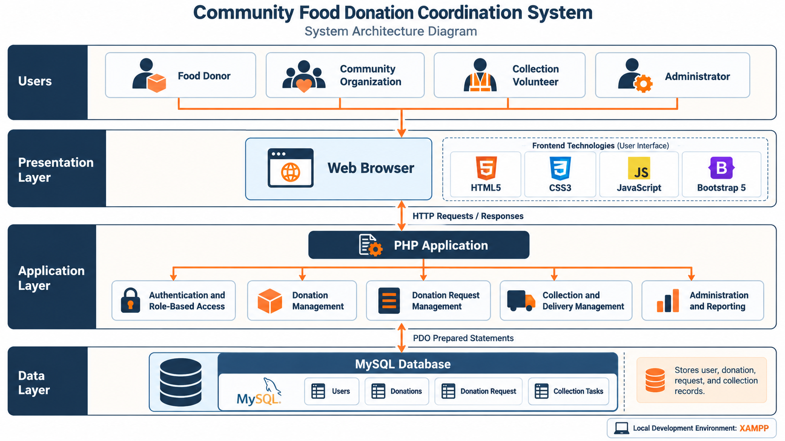
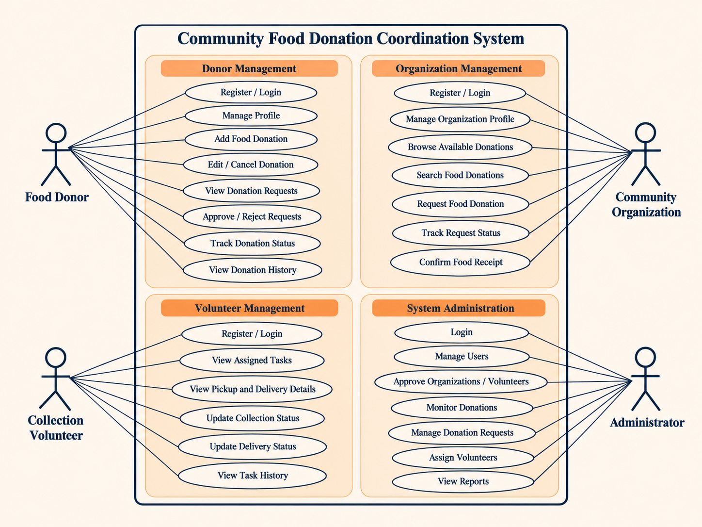

<div align="center">

# 🍽️ Community Food Donation Coordination System

### Connecting Surplus Food with Communities in Need

**A web-based food donation coordination platform | University Software Engineering Group Project**

    

</div>

---

## 📖 Overview

The **Community Food Donation Coordination System** is a web-based application designed to connect food donors, community organizations, and collection volunteers through one centralized platform. It aims to help reduce food waste, improve donation coordination, and support the distribution of surplus food to communities in need.

The platform provides role-specific features for donors, community organizations, collection volunteers, and administrators. It supports the donation process from food listing and requests through collection, delivery, and receipt confirmation.

## 🎯 Objectives

- Reduce avoidable food waste by making surplus food easier to share.
- Help community organizations discover and request available donations.
- Coordinate food collection and delivery through volunteers.
- Provide visibility into donation and request statuses.
- Support organized administration and recordkeeping.

## ✨ Key Features

| User Role | Main Capabilities |
|---|---|
| **Food Donor** | Register and sign in; manage profile; add, edit, or cancel donations; review and approve or reject requests; track donation status and history. |
| **Community Organization** | Register and sign in; manage organization profile; browse and search donations; submit requests; track request status; confirm receipt. |
| **Collection Volunteer** | Register and sign in; view assigned tasks and pickup/delivery details; update collection and delivery statuses; view task history. |
| **Administrator** | Sign in; manage users and approvals; monitor donations and requests; assign volunteers; review reports and activity. |

> **Implementation note:** The table describes the planned system scope. Update it to reflect the features actually completed and tested before final submission.

## 🏗️ System Architecture

The project uses a **three-tier web application architecture**:

1. **Presentation layer:** HTML5, CSS3, JavaScript, and Bootstrap 5 provide the user interface in a browser.
2. **Application layer:** PHP handles application logic, authentication, authorization, donations, requests, and volunteer workflows.
3. **Data layer:** MySQL stores application data such as users, donations, requests, and collection tasks.

<div align="center">



*Figure 1. System Architecture — Community Food Donation Coordination System*

</div>

## 👥 UML Use Case Diagram

The use case diagram illustrates how the system's four actors interact with the application: **Food Donor**, **Community Organization**, **Collection Volunteer**, and **Administrator**.

<div align="center">



*Figure 2. UML Use Case Diagram — Community Food Donation Coordination System*

</div>

## 🔄 Donation Workflow

```text
Food Donor Lists Food
         ↓
Community Organization Requests Food
         ↓
Food Donor Reviews Request
         ↓
Volunteer Is Assigned
         ↓
Food Is Collected
         ↓
Food Is Delivered
         ↓
Organization Confirms Receipt
         ↓
Donation Completed
```

A typical status progression is **Available → Requested → Assigned → Collected → Delivered → Completed**. Requests may also be rejected or donations cancelled, subject to the application's rules.

## 🛠️ Technology Stack

| Area | Technology |
|---|---|
| Frontend | HTML5, CSS3, JavaScript |
| UI Framework | Bootstrap 5 |
| Backend | PHP |
| Database | MySQL |
| Local Server | XAMPP (Apache and MySQL) |
| Version Control | Git and GitHub |

## 📁 Project Structure

The structure below is an **illustrative layout**. Adjust directory names to match the actual repository.

```text
community-food-donation-system/
├── admin/                 # Administrator pages
├── donor/                 # Donor pages
├── organization/          # Organization pages
├── volunteer/             # Volunteer pages
├── includes/              # Shared PHP components
├── assets/
│   ├── css/               # Stylesheets
│   ├── js/                # JavaScript files
│   └── images/            # Website assets
├── database/              # Database schema / safe sample data
├── images/                # README documentation diagrams
│   ├── system-architecture.png
│   └── use-case-diagram.png
├── index.php
└── README.md
```

## 🚀 Local Setup

### Prerequisites

- XAMPP with Apache, PHP, and MySQL
- A modern web browser
- Git (optional if downloading the ZIP)

### Installation

1. Clone the repository or download it as a ZIP:

   ```bash
   git clone https://github.com/<YOUR-GITHUB-USERNAME>/community-food-donation-system.git
   ```

2. Place the project folder inside your XAMPP `htdocs` directory, for example:

   ```text
   C:\xampp\htdocs\community-food-donation-system
   ```

3. Open **XAMPP Control Panel** and start **Apache** and **MySQL**.
4. Open [phpMyAdmin](http://localhost/phpmyadmin/) and create the database required by the project's SQL schema.
5. Import the SQL schema provided in the repository, if available.
6. Configure the application's local database connection using the actual project configuration instructions. **Do not commit passwords, private credentials, or production database exports.**
7. Visit:

   ```text
   http://localhost/community-food-donation-system/
   ```

> **Before publishing:** Replace `<YOUR-GITHUB-USERNAME>` with the repository owner's GitHub username, and verify the database name, SQL filename, configuration steps, and local URL against the working application.

## 🧪 Testing Areas

- Registration, login, and session handling
- Access restrictions for different user roles
- Donation creation, editing, and cancellation
- Donation search and requests
- Request approval and rejection
- Volunteer task assignment and status updates
- Delivery and receipt confirmation
- Form validation and database operations
- Responsive layouts across device sizes

## 🔒 Security Features

Security is an important part of the Community Food Donation Coordination System. The following safeguards are **planned or recommended** for the application and must be checked against the implemented PHP code before being marked as completed.

| Security Feature | Purpose |
|---|---|
| **Secure Password Hashing** | Store passwords using PHP `password_hash()` and verify them using `password_verify()` instead of storing plaintext passwords. |
| **Authentication and Session Management** | Restrict account access to authenticated users, regenerate session IDs after login, and securely handle logout. |
| **Role-Based Access Control (RBAC)** | Ensure donors, organizations, volunteers, and administrators can access only their authorized pages and actions. |
| **SQL Injection Prevention** | Use PDO prepared statements with bound parameters for database queries. |
| **Cross-Site Scripting (XSS) Protection** | Validate inputs and escape untrusted content when displaying it in HTML. |
| **Cross-Site Request Forgery (CSRF) Protection** | Use CSRF tokens for state-changing forms and requests. |
| **Server-Side Input Validation** | Validate required fields, lengths, formats, quantities, and user permissions on the server. |
| **Secure Database Configuration** | Keep database credentials and other secrets out of public GitHub commits; use a local ignored configuration file or environment variables. |
| **Safe Error Handling** | Log technical errors privately without exposing SQL details, credentials, or stack traces to users. |
| **File Upload Validation (if applicable)** | Restrict allowed file types and sizes, rename uploaded files safely, and prevent execution of uploaded content. |
| **HTTPS and Secure Cookies (for deployment)** | Use HTTPS and appropriate `HttpOnly`, `Secure`, and `SameSite` session cookie settings in production. |
| **Authorization Checks for Records** | Verify ownership and permissions before allowing users to edit donations, approve requests, or update delivery statuses. |

> **Implementation status:** This section documents the intended security controls, **not a claim that every control is already implemented**. Review and test the code, then update this table to distinguish completed features from planned improvements.

### Responsible Repository Practices

- Never commit `.env` files, passwords, API keys, or private configuration.
- Use `.gitignore` for local secrets and generated files.
- Share a safe example configuration file with placeholder values.
- Avoid uploading real personal information or sensitive database backups.
- Review changes before merging them into `main`.

## 🎓 Academic Information

- **Project:** Community Food Donation Coordination System
- **Project Category:** Software Engineering Group Project
- **University:** University of Ruhuna
- **Faculty:** Faculty of Technology
- **Degree Programme:** Bachelor of Information and Communication Technology (Honours)

## 👨‍💻 Development Team

- **Dinesha Navod**
- **Bhashitha Dilshan**
- **Chalindu Jayasooriya**
- **Chenuka Hasith**
- **Maneesha Pavitranjali**

## 📌 Project Note

This repository is maintained for academic and educational purposes. Features, screenshots, setup details, and documentation may be updated as the project progresses.

---

<div align="center">

**Community Food Donation Coordination System**  
*Reducing Food Waste • Supporting Communities • Improving Coordination*

</div>
