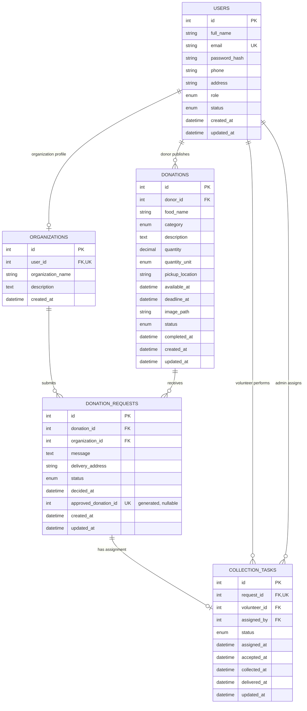
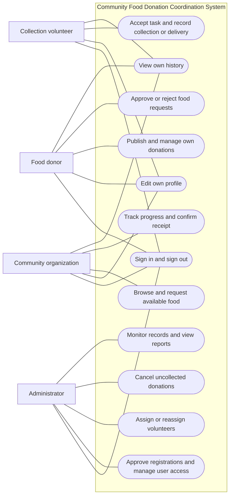
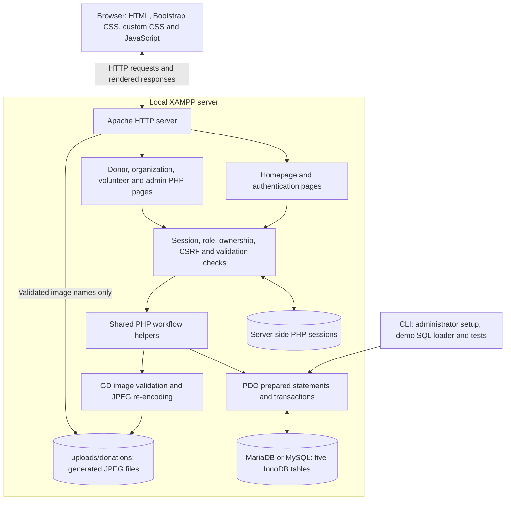

# System diagrams

These Mermaid diagrams describe the implemented five-table PHP application.
Open this Markdown file in a Mermaid-capable preview to view them. Diagram source
is included directly in the file so it can be edited and copied into project documentation.

## Entity relationship diagram

`users` stores all four roles. Role restrictions on donor_id, volunteer_id and
assigned_by are checked in PHP; the foreign keys alone establish user existence.
One organization profile belongs to one organization user. A request is unique
for the pair (donation_id, organization_id). Its generated approved_donation_id
is populated only when approved; a unique index permits one approved request per
donation while allowing multiple pending requests. A request has at most one task.
Reassignment updates that task rather than inserting a duplicate.

## Use-case overview

Mermaid flowchart notation is used for actors, oval use cases and the system boundary.
Associations show which role can perform each use case; they do not represent sequence.

Public registration supports donors, organizations and volunteers. Organization
and volunteer registrations require approval; administrator provisioning is CLI-only.
All protected actions also require the correct role, ownership, current workflow
state and a valid CSRF token. Administrator profile editing is not implemented.

## Basic system architecture

Pages render HTML on the server; this is not a single-page application. Photo
files are stored on disk, while their paths are stored in donations.image_path.
Internal source, SQL, tests and documentation directories are blocked through
Apache .htaccess files. PHP files in role directories enforce authentication and
authorization before rendering or changing data. CLI fixtures use separate
temporary records/tables and preserve real application history.
